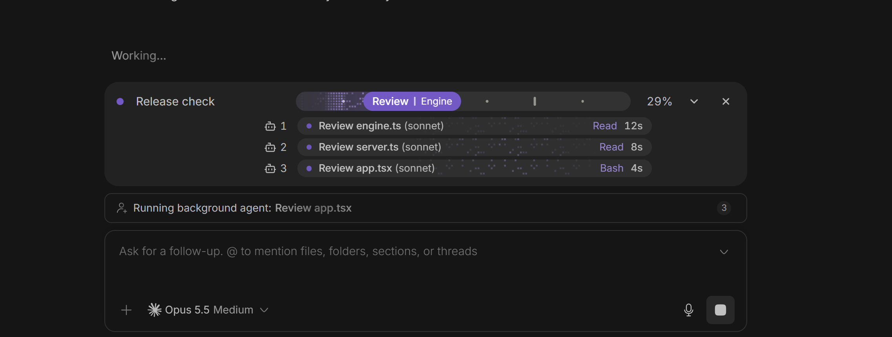
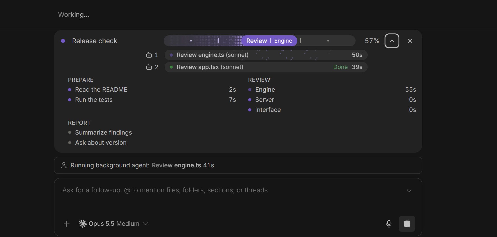
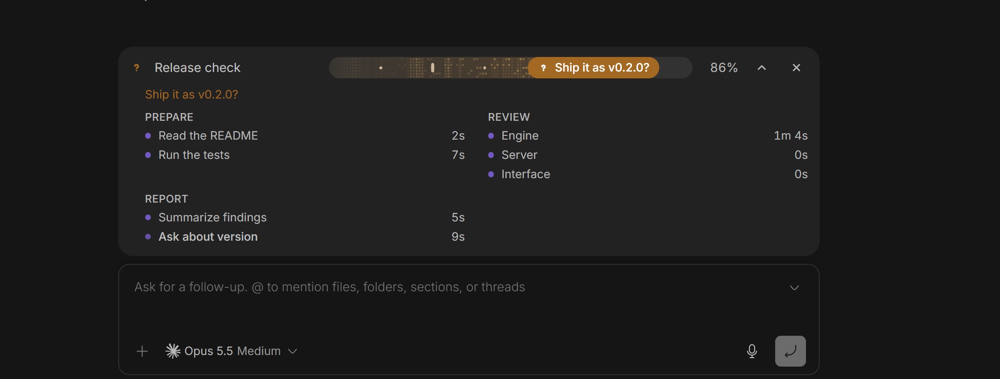
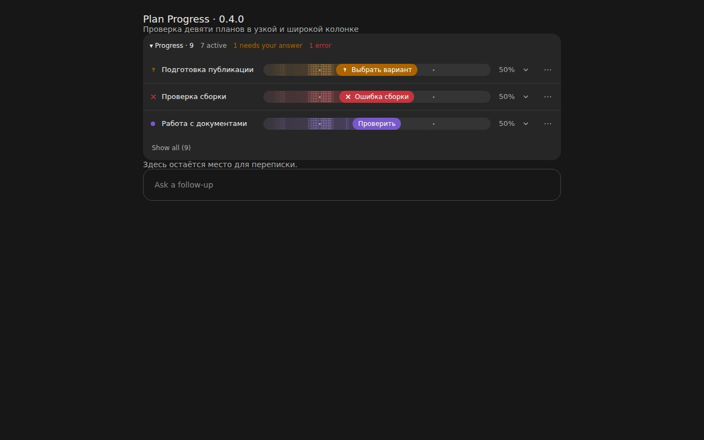

# Plan Progress for BB

Live progress bars above a thread's message box in [BB](https://getbb.app).
The agent splits a task into stages and steps with the `plan_progress` tool,
and the bar fills as it works: working, needs your answer, error, done.



| The step list, with the time of each step | Waiting on the user: the agent's question on the bar |
| --- | --- |
|  |  |

A port of the idea and protocol of
[plan-progress](https://github.com/zycck/claude-mods) by zycck, a mod for
Claude Code (MIT). The original draws inside Claude Code's own window, which
BB does not show; this plugin draws the bar in BB instead, and registers the
tool for BB agents rather than for Claude Code alone.

## Install

```bash
bb plugin install https://github.com/mrsu-smirnov/bb-plugin-plan-progress.git
```

Agent tools reach a thread when its session starts: start a new thread, or
restart the agent in an open one, after installing.

## Use

Ask the agent for any task of several steps. It creates a bar, moves it after
each step, marks it before asking you something, and finishes it. Click the
bar to see every bar of the thread.

The same ops work from a terminal inside a thread:

```bash
bb plan-progress show
bb plan-progress op '{"id":"demo","title":"Demo","steps":[{"title":"One"},{"title":"Two"}]}'
bb plan-progress op '{"id":"demo","next":true}'
bb plan-progress clear
```

The protocol is in [skills/plan-progress/SKILL.md](skills/plan-progress/SKILL.md).

### Claude Desktop and BB together

The original zycck mod may stay enabled in Claude Desktop. By default this
plugin gives only BB's Claude thread processes a session-only settings override
that disables `plan-progress@zycck-mods`. It does not change Claude settings
files, uninstall the mod, or patch BB's built-in provider. The launcher is
prepared automatically on the selected enrolled machine. Start a new thread
after an update; existing sessions may retain old instructions and tools.

For Claude the correct tool is `mcp__bb-bridge__plan_progress`, not
`mcp__plan-progress__plan_progress`. Codex and Pi use BB's tool under their
provider's advertised name. Successful calls return `BB/<threadId>`.

`bb plan-progress diagnose --json` reports the last recognized tool route and
whether isolation is requested. A detected original-tool call shows a warning
above the composer, even when BB has no bars. Isolation being requested is not
proof that an existing provider session was restarted with it.

The agent receives an explicit rule for tasks with three or more actions,
including read-only work. The plugin can send at most one automatic reminder
per active turn after three work calls without a bar or six without an update.
It uses strict steering and does not start another turn. Model compliance still
cannot be guaranteed; this is not a universal gate before every work tool.
The original tool is isolated only for the known `plan-progress@zycck-mods` id.
An installation under another marketplace id requires separate configuration.

Earlier isolation and basic progress features were validated on Linux with Claude Code, Codex, and Pi; this does not validate the new 0.5.0 event handling. The Windows launcher follows
the Claude SDK's JavaScript executable contract, but has not been tested on a
Windows host. Claude Desktop's GUI was not driven in these checks: the native
plugin list confirms enabled in an ordinary launch, disabled in the BB launch,
with the settings file unchanged.

### Compatibility candidate: 0.6

The agent creates the bar by calling BB's tool; the plugin does not infer every
user task. The standing rule is three or more actions, including reads. Short
answers and conversation need no bar. **About progress** in the banner explains
this by click/tap. The same rule applies regardless of model, but model compliance
is measured separately from tool availability and execution.

`bb plan-progress diagnose --json` now reports provider identity when readable,
the last requested model (not a guarantee of the active session model), recognized
call outcome, the last native/CLI execution observed by this plugin runtime,
reminder delivery, bounded-history coverage, and each plan's state, finished-step
count and auto-hide conditions. It never sends a reminder itself. Unknown or
unavailable evidence stays unknown. Reports omit conversation text, commands and
tool arguments. The report is an observation assembled from several reads, not
an atomic snapshot or proof of a missing tool.

An idle thread may still have an open plan. Explicit `state:"done"` does not
change step statuses. Auto-close waits for a done plan, its delay and tracked
helpers; restored finishes stay visible. Server conditions are not proof that a
particular browser has already hidden the row (its page may be closed or stale).
Existing settings and hidden plans are preserved.

Reminders exclude native helper scopes, retain an attempted send across plugin
reload, and reset their budget on a proven new root start. Failed/unknown sends
are recorded without starting a new turn. A bounded window missing a start, or
an unexpected turn scope, can suppress a reminder until the next proven start.
Legacy unscoped envelopes retain the older fallback; they cannot establish a
root identity. Sending once is not proof that a model read or followed it.

BB's public tool context does not expose a stable invocation ID. Repeating
`next:true` advances twice; no automatic deduplication is promised. If a result
is lost, inspect `bb plan-progress show --json` once, then update uniquely named
steps. Reloading a browser, reloading a plugin and recreating a provider session
are different operations: tools/instructions change only at session boundaries.

Live candidate observations cover Codex `gpt-6.1-sol` and OpenCode v2
`opencode-go/claude-haiku-5-5` using existing connections. This is not validation
of every model or subscription. Pi/Ollama Cloud, Pi/OpenRouter and fresh Claude
Code remain unverified on this host. The exact models used by the external tester
are still unknown. See [verification and limitations](docs/upstream-coverage.md).

### Answer speed

`⚡ ≈ 42 tok/s` stands in the message box before the voice and send buttons,
as in the original: bright while the model writes, dimmed with the last
figure while a tool runs and between turns. It is the average over the latest
minute of writing; the time a tool runs does not count, and subagents do not
count.

It is an estimate, as the original's live figure is: BB tells a plugin the
exact output tokens only at the end of the agent's run, and Claude Code hands
its text over a block at a time. So the plugin counts the characters the
agent writes (text, thinking, tool calls) at a tokens-per-character ratio
learned from the exact counts, which this browser keeps. When BB reports the
exact count, the figure loses its `≈`. The box hides it in its compact,
one-line layout.

## Compact plans (0.4.0)



[See the narrow-screen layout](media/compact-mobile.jpg).

Click **Progress · N** to fold or show the entire block. The choice is remembered
for this thread in this browser and is not reset by new plans or updates.
The summary still shows how many plans need your answer or have errors.

Three plans are shown at a time, with questions and errors first. **Show all**
opens the full list. On narrow screens the title and track have separate lines.
Use a plan's **… → Hide plan** menu to hide it; **Hidden plans → Restore** brings
it back. Hidden plans keep receiving agent updates. A new question or error
brings a hidden plan back to attention. Hiding never stops an agent or removes
a thread or its files.

Finished plans hide after 30 seconds by default, once the thread's tracked
agents have finished. They remain in Hidden plans. Restoring a finished plan
keeps that completion visible. Existing saved auto-close preferences are kept.

Plans are no longer silently discarded when the list grows beyond twelve.
A thread retains up to 100 plans, within a 240 KB storage budget. At the safety
limit a new operation is refused without removing existing plans. Start a new
thread or deliberately use `bb plan-progress clear` to remove all its plans;
that explicit clear command is permanent. Plans removed by older versions
cannot be recovered by this update.

## Coverage and verification

The full [upstream inventory and 0.5.0 changes](docs/upstream-coverage.md)
separate implemented behavior, remaining differences and verification limits.

## 0.5.0: coverage and limits

The thread-level agents list is independent of plans. It shows at most three
rows by default, prioritises errors and running work, and remembers expansion
in this browser for each thread. The Progress control hides the list without
changing its expansion choice. Error traces are retained in plugin storage,
with a limit of 100 per thread. Completed rows disappear after five seconds.
Pending approvals in the current thread and direct child threads are counted
without attributing them to an individual agent.

Delegations in BB's `turn.children` groups are collected as a flat list.
Delegation rows and background workflow items are matched through `childRef`
and item IDs; normalized background task events supply confirmed outcomes.
A launch or an absent active task is not proof of success. Child outcomes require the latest request to be accepted by a root turn and
use that turn’s completion, never a native helper’s completion or idle alone. The
child model is hidden during active work, and child duration is not displayed.
Reads are bounded to 500 recent events and 500 direct children; the list is not
an arbitrary ownership tree. Historical errors are retained once observed.

Skipped steps count as finished in text, track and ARIA. A plan may show 100%
while its state is needs_input or error. A stage boundary shows the wall-clock
span from the first observed step start to the last observed step end: gaps and
overlap are included, so this is not summed effort or a measure of parallel
work. If no start/end was observed, no duration is displayed.

Thread activation alone does not clear needs_input. A visible human request
accepted by the provider clears an older waiting state; hidden agent-only input,
system messages, other agents and retries do not. An explicit plan op also
changes the state. Matching uses request IDs and request timestamps; bounded
event reads and timestamps mean very old or indistinguishable events cannot
be proved. Live event evidence for the new Claude and Pi scenarios is still
needed; those providers are not currently registered on the test host. The
prior 0.4.0 audit is preserved in [the coverage inventory](docs/upstream-coverage.md). This is a partial port of
pinned upstream `b77335ee560c609d67ae85c7321f886719361426`.

## Develop

```bash
npm install
npm test          # the bar engine
npm run test:integration # build and exercise the backend and host launcher
npm run typecheck
npm run test:ui    # real banner through the public SDK UI harness
bb plugin install .
bb plugin dev     # rebuild and reload on save
```

The bars are a composer banner and the speed a composer action
(`app.composer.customize`).

## Settings

In bb: Settings → Plugins → Plan Progress → the gear at the top right →
Configuration. Or from a terminal: `bb plugin config plan-progress set <key> <value>`.

| Setting | Key | Default |
| --- | --- | --- |
| Effects: twinkling dots in the bar | `effects` | on |
| Session-only isolation of the original Claude mod | `isolateClaude` | on |
| Optional absolute native Claude executable path on the host | `claudeExecutable` | empty: find on PATH |
| One automatic progress reminder per active turn | `automaticReminders` | on |
| Auto-close: hide finished plans; restore from Hidden plans | `autoClose` | on |
| Stays for: 10, 30 or 60 s before it leaves | `autoCloseSeconds` | 30 |
| Answer speed: ≈ tok/s in the message box | `speed` | on |
| Sounds: a chime on a question, an error and the finish | `sounds` | off |

## License

MIT. See [LICENSE](LICENSE).
