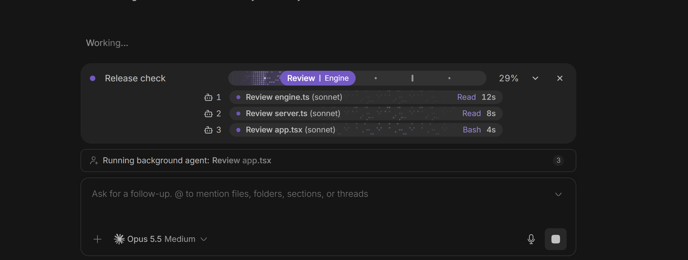
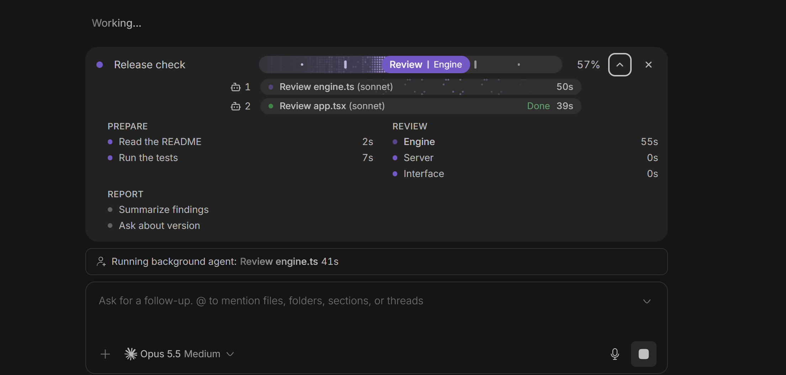
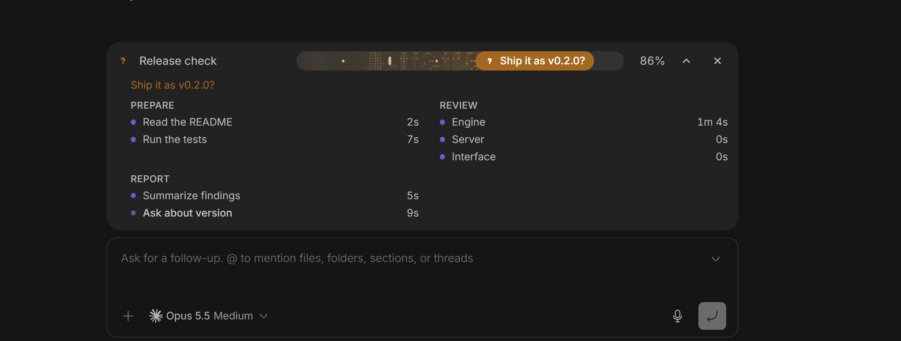
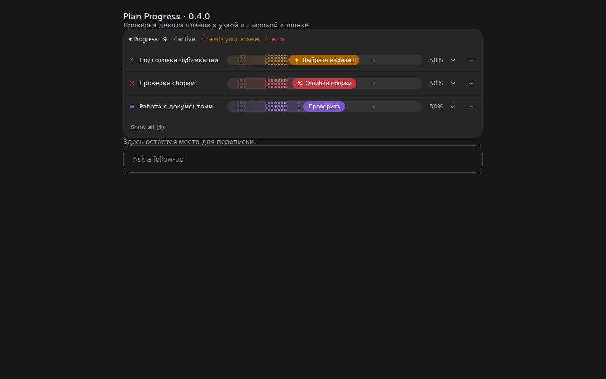

# Plan Progress for BB

Live progress bars above a thread's message box in [BB](https://getbb.app).
The agent splits a task into stages and steps with the `plan_progress` tool,
and the bar fills as it works: working, needs your answer, error, done.



| The step list, with the time of each step | Waiting on the user: the agent's question on the bar |
| --- | --- |
|  |  |

A port of the idea and protocol of
[plan-progress](https://github.com/zycck/claude-mods) by zycck, a mod for
Claude Code (MIT). The original draws inside Claude Code's own window, which
BB does not show; this plugin draws the bar in BB instead, and registers the
tool for BB agents rather than for Claude Code alone.

## Install

```bash
bb plugin install https://github.com/mrsu-smirnov/bb-plugin-plan-progress.git
```

Agent tools reach a thread when its session starts: start a new thread, or
restart the agent in an open one, after installing.

## Use

Ask the agent for any task of several steps. It creates a bar, moves it after
each step, marks it before asking you something, and finishes it. Click the
bar to see every bar of the thread.

The same ops work from a terminal inside a thread:

```bash
bb plan-progress show
bb plan-progress op '{"id":"demo","title":"Demo","steps":[{"title":"One"},{"title":"Two"}]}'
bb plan-progress op '{"id":"demo","next":true}'
bb plan-progress clear
```

The protocol is in [skills/plan-progress/SKILL.md](skills/plan-progress/SKILL.md).

### Claude Desktop and BB together

The original zycck mod may stay enabled in Claude Desktop. By default this
plugin gives only BB's Claude thread processes a session-only settings override
that disables `plan-progress@zycck-mods`. It does not change Claude settings
files, uninstall the mod, or patch BB's built-in provider. The launcher is
prepared automatically on the selected enrolled machine. Start a new thread
after an update; existing sessions may retain old instructions and tools.

For Claude the correct tool is `mcp__bb-bridge__plan_progress`, not
`mcp__plan-progress__plan_progress`. Codex and Pi use BB's tool under their
provider's advertised name. Successful calls return `BB/<threadId>`.

`bb plan-progress diagnose --json` reports the last recognized tool route and
whether isolation is requested. A detected original-tool call shows a warning
above the composer, even when BB has no bars. Isolation being requested is not
proof that an existing provider session was restarted with it.

The agent receives an explicit rule for tasks with three or more actions,
including read-only work. The plugin can send at most one automatic reminder
per active turn after three work calls without a bar or six without an update.
It uses strict steering and does not start another turn. Model compliance still
cannot be guaranteed; this is not a universal gate before every work tool.
The original tool is isolated only for the known `plan-progress@zycck-mods` id.
An installation under another marketplace id requires separate configuration.

Validated on Linux with Claude Code, Codex, and Pi. The Windows launcher follows
the Claude SDK's JavaScript executable contract, but has not been tested on a
Windows host. Claude Desktop's GUI was not driven in these checks: the native
plugin list confirms enabled in an ordinary launch, disabled in the BB launch,
with the settings file unchanged.

### Answer speed

`⚡ ≈ 42 tok/s` stands in the message box before the voice and send buttons,
as in the original: bright while the model writes, dimmed with the last
figure while a tool runs and between turns. It is the average over the latest
minute of writing; the time a tool runs does not count, and subagents do not
count.

It is an estimate, as the original's live figure is: BB tells a plugin the
exact output tokens only at the end of the agent's run, and Claude Code hands
its text over a block at a time. So the plugin counts the characters the
agent writes (text, thinking, tool calls) at a tokens-per-character ratio
learned from the exact counts, which this browser keeps. When BB reports the
exact count, the figure loses its `≈`. The box hides it in its compact,
one-line layout.

## Compact plans (0.4.0)



[See the narrow-screen layout](media/compact-mobile.jpg).

Click **Progress · N** to fold or show the entire block. The choice is remembered
for this thread in this browser and is not reset by new plans or updates.
The summary still shows how many plans need your answer or have errors.

Three plans are shown at a time, with questions and errors first. **Show all**
opens the full list. On narrow screens the title and track have separate lines.
Use a plan's **… → Hide plan** menu to hide it; **Hidden plans → Restore** brings
it back. Hidden plans keep receiving agent updates. A new question or error
brings a hidden plan back to attention. Hiding never stops an agent or removes
a thread or its files.

Finished plans hide after 30 seconds by default, once the thread's tracked
agents have finished. They remain in Hidden plans. Restoring a finished plan
keeps that completion visible. Existing saved auto-close preferences are kept.

Plans are no longer silently discarded when the list grows beyond twelve.
A thread retains up to 100 plans, within a 240 KB storage budget. At the safety
limit a new operation is refused without removing existing plans. Start a new
thread or deliberately use `bb plan-progress clear` to remove all its plans;
that explicit clear command is permanent. Plans removed by older versions
cannot be recovered by this update.

## Coverage against the original (audit: 2026-10-30)

This is a partial port, not feature parity. Compared BB 0.4.0
(`d3d3a133e5ba39da5cb5908cf2d254205a315fd7`) against a fresh Git clone of
[zycck/claude-mods at b77335e](https://github.com/zycck/claude-mods/tree/b77335ee560c609d67ae85c7321f886719361426/plugins/plan-progress).
That is still upstream main and is identical to our recorded original baseline.
This audit reads the implementation, types, settings, skill and regression
scenarios; it does not claim live equivalence across platforms or providers.

| Capability | BB 0.4.0 compared with upstream |
| --- | --- |
| Plans, stages, steps, short updates, replanning, restart under the same id | Core operations supported, not exact protocol compatibility. BB retains case/spaces in ids and limits plans to 12 stages × 30 steps; upstream slugs ids and has no matching normalizer limits |
| Four plan states, progress marks and effects | Present; drawing uses React/CSS rather than SVG and terminal raster frames |
| Step and stage timings | Partial: BB tracks active-step intervals. Upstream estimates intervals between completions. BB currently labels stage boundaries with the last step time, not the stage duration |
| Expandable step list | BB addition; the upstream row has no equivalent expandable list |
| Reduced-motion preference | Partial: track animations respect it; pulsing step/agent dots are not all disabled by that rule |
| Answer speed | Partial: estimated from BB events, corrected with final token counts; model changes do not reset the meter as upstream does. Exact tokens do not make measured writing time exact |
| Sounds | Partial: browser-synthesised tones, default off, versus upstream host WAV sounds, default on. A newly seen bar does not chime without an observed state transition |
| Persistence | Present per BB thread in KV; upstream has its own last-20-session save/restore mechanism |
| Hide all plans | Present in 0.4.0 with a persistent Progress button. Upstream uses `/progress`; a new plan reopens its block |
| Completed-plan auto-close | Partial. **Upstream defaults to off**; BB defaults to on. Both initially use 30 seconds. BB runs this in the mounted browser and waits for any tracked agent in the thread; upstream uses a process timer and the agents of that plan |
| Plan-list length | BB shows three and retains hidden plans. Upstream retains at most three and evicts older plans |
| Individual hide/restore | BB addition. Upstream's cross removes the plan; it has no hidden-plan restore list |
| Limit the number of agent strips | **Missing.** Upstream budgets 3/4/5 rows according to the number of bars, prioritises unfinished agents and adds a `+N more · K done` row. Our current AgentStrips maps every visible agent |
| Fold agent strips | Partial, with a reproduced state-loss bug: folding/unfolding the whole Progress block remounts and resets the locally folded agents. Upstream stores the choice on the plan and has `/progress-agents` |
| Readable model/tool labels in narrow strips | Partial. Upstream shortens Claude model names and MCP tool prefixes, drops tool/time before the task name in a narrow strip, and marks nested agents. BB mostly truncates the combined title/model; child-thread tools are absent |
| Automatic Agents bar without a task plan | **Missing.** Upstream creates `agents:auto` without a model call. BB hides agents when there is no rendered host plan. The same disappearance is reproduced with a hidden host plan or one outside the first three rows |
| Bind agents to their own plan | **Missing equivalent.** Upstream stores home plan and parent/depth; BB assigns the aggregate to the latest updated unfinished plan, so another plan update can relocate it |
| Collect nested agents | **Missing.** BB requests nested timeline rows but its collector does not recurse into childRows; a nested delegation is absent in a synthetic fixture |
| Waiting for approval | **Missing agent state.** Upstream turns a strip amber while a real permission dialog is open. BB AgentState is running/done/error |
| Resumed agents and teammates | Incomplete lifecycle support. BB rereads status but caches the first child-thread model and uses thread creation/updatedAt for duration. Upstream tracks current model, resting/woken agents, missing finish events and ownership handover |
| Confirm background task outcomes | Incomplete: BB can treat successful launch completion as task success after it leaves the active list; taskStatus is not read. A failed-background fixture yields done. Live provider event sequences still need validation |
| Fold a completed group | Different: BB hides each completed agent after five seconds; upstream waits five seconds after the entire group completes |
| Keep failed agent strips visible | Different: upstream keeps failed strips with the bar until it closes; BB filters errors out after two minutes |
| Parse an approved Plan Mode plan into a bar | **Missing.** Upstream handles ExitPlanMode and builds/updates the `plan` bar from Markdown; BB currently relies on the agent to call the progress tool |
| Detect a question automatically | Partial. Upstream intercepts AskUserQuestion/Stop; BB relies on explicit needs_input. BB clears waiting plans on any thread.active; that event alone does not establish a human answer |
| Remind the agent of existing plans at a new human prompt | **Missing equivalent.** Upstream adds a short list of open plan ids and positions to prompt context |
| Enforce a plan before repeated edits | **Missing equivalent.** Upstream refuses the fourth edit once if no plan exists, exempting shell calls and plan-file writes; BB sends a bounded reminder after work calls instead |
| Remind repeatedly about stale plans | Different: upstream can nudge every six successful edits with an open plan; BB sends at most one reminder per active turn and counts reads/commands too |
| Check open plans before ending the answer | **Missing.** Upstream's Stop hook can block one unexplained finish, while allowing questions/background waits. BB does not block a completed turn |
| Settings shortcut next to speed | **Missing.** Upstream has a gear and `/plan-progress-settings`; BB settings are reached through host plugin settings |
| Localised settings and update UI | **Missing.** Upstream contains 35 language tables and chooses language from Claude/app/system settings. Our plugin labels are English |
| Plugin-specific update check and notice | BB provides installation/update management; a duplicate updater is not needed. Upstream has a six-hour check and gear badge; equivalent notice timing in BB has not been established |
| Arbitrary auto-close delay | Different: upstream config accepts positive seconds; BB offers 10/30/60 |
| Theme-specific terminal drawing, Omarchy and OS appearance probes | Terminal probes are not applicable as-is. Light-theme contrast remains applicable: upstream has a separate light palette for agent strips; BB fixed colours need a browser audit |
| Missing-tool warning | Different: upstream checks whether the loopback MCP tool reached the session and warns once. BB diagnoses original-vs-BB tool collisions and isolates the Desktop mod; it has no equivalent preflight for a missing BB tool |
| Substeps | Not an omitted working UI: upstream types/Markdown parser retain them, but the public step schema deliberately omits them, drawing does not display them, and short ops cannot address them |

Additional rendering differences found by source inspection:

- Upstream caps an unfinished plan's displayed percent at 99. BB can show 100
  while state is needs_input or error.
- BB's numeric percent counts skipped steps as finished, but its track fill's
  head helper currently counts only done. A skipped step can make the fill and
  numeric percent disagree.
- Upstream positions the pill's stage/step by the completed share of the track;
  BB uses the active/error step. Completing steps out of order can therefore
  produce different pill labels.
- Independent SDK-harness review reproduced the skipped-step disagreement: one skipped step of two gives text 50%, fill 0%, and ARIA 0. It also reproduced loss of the agent fold choice and disappearing agents for hidden/out-of-view/no host plans.
- On the same timed operations, a stage boundary showed 15 seconds upstream versus 10 in BB, and a never-active step showed 5 seconds upstream versus 0 in BB. These confirm different semantics; neither estimate is an exact measurement of parallel work.
- Browser layout, live provider event sequences and the remaining edge cases still need separate verification.

Corrections to earlier comparisons: upstream auto-close is **off**, and its
whole-block toggle is the `/progress` command, not a Progress-count button.
The earlier comparison did not inspect the complete pinned source. A fresh
clone at the pinned commit is the evidence for this table.
A claim of complete parity must be backed by this inventory and scenario
checks, not by the number of passing tests in the port alone.

### Proposed 0.5.0 scope after independent review (not yet approved)

1. A standalone, compact thread-level agents block, independent of which plan
   happens to be visible: at most three rows plus a summary, expandable list,
   counts by outcome, persistent fold choice, readable task names at 390 px.
2. Trustworthy states for existing delegation/child-thread sources: distinguish
   launch from completion, retain a trace of errors, observe real approval
   waits, do not label unknown outcomes as success, and avoid stale model/time
   values on resumed work. No full plan-ownership tree is required for this step.
3. Consistent existing plan displays: count skipped steps equally in numeric,
   visual and accessible progress; report stage time as stage time; do not call
   unknown duration measured zero; do not clear needs_input solely because the
   thread became active. Choose/document the meaning of 100% while awaiting a
   decision rather than automatically copying upstream's 99% cap.

Acceptance should cover 0/1/3/10 agents with 0/1/9 plans, hidden/out-of-view
plans, fold/reload, real approval and background success/failure sequences,
resumed runs, light/dark themes and reduced motion. Functions advertised for
Claude/Codex/Pi need evidence from the respective provider events.

Defer full ownership/agent trees and handover, Plan Mode import, automatic
question detection, blocking enforcement, translations/settings shortcuts,
arbitrary delay and exact animation/speed parity. Keep host-managed updates.

The review checked public SDK 0.6.79: generic hooks expose message.dispatch,
not upstream tool.call/Stop interception; observed events cannot block an
already completed action. Interaction lifecycle/read APIs do exist, while
turn/plan/updated alone does not prove human approval. These findings are
version-specific, not a claim about every newer SDK or provider extension.
Before implementation, inspect current supported SDK contracts and capture
anonymised live event sequences, stable ids, pagination/recovery and stale RPC
races. A missing feature alone is not evidence of a platform limitation.

## Develop

```bash
npm install
npm test          # the bar engine
npm run test:integration # build and exercise the backend and host launcher
npm run typecheck
npm run test:ui    # real banner through the public SDK UI harness
bb plugin install .
bb plugin dev     # rebuild and reload on save
```

The bars are a composer banner and the speed a composer action
(`app.composer.customize`).

## Settings

In bb: Settings → Plugins → Plan Progress → the gear at the top right →
Configuration. Or from a terminal: `bb plugin config plan-progress set <key> <value>`.

| Setting | Key | Default |
| --- | --- | --- |
| Effects: twinkling dots in the bar | `effects` | on |
| Session-only isolation of the original Claude mod | `isolateClaude` | on |
| Optional absolute native Claude executable path on the host | `claudeExecutable` | empty: find on PATH |
| One automatic progress reminder per active turn | `automaticReminders` | on |
| Auto-close: hide finished plans; restore from Hidden plans | `autoClose` | on |
| Stays for: 10, 30 or 60 s before it leaves | `autoCloseSeconds` | 30 |
| Answer speed: ≈ tok/s in the message box | `speed` | on |
| Sounds: a chime on a question, an error and the finish | `sounds` | off |

## License

MIT. See [LICENSE](LICENSE).
